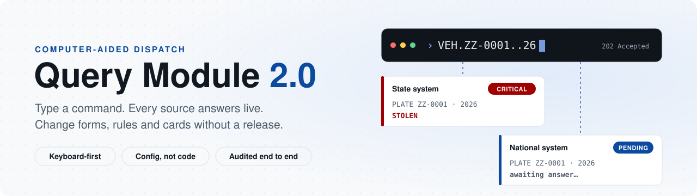
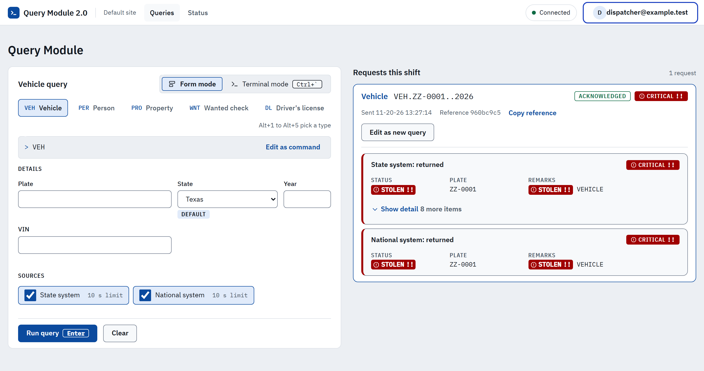
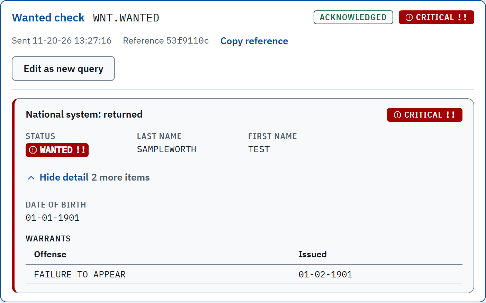
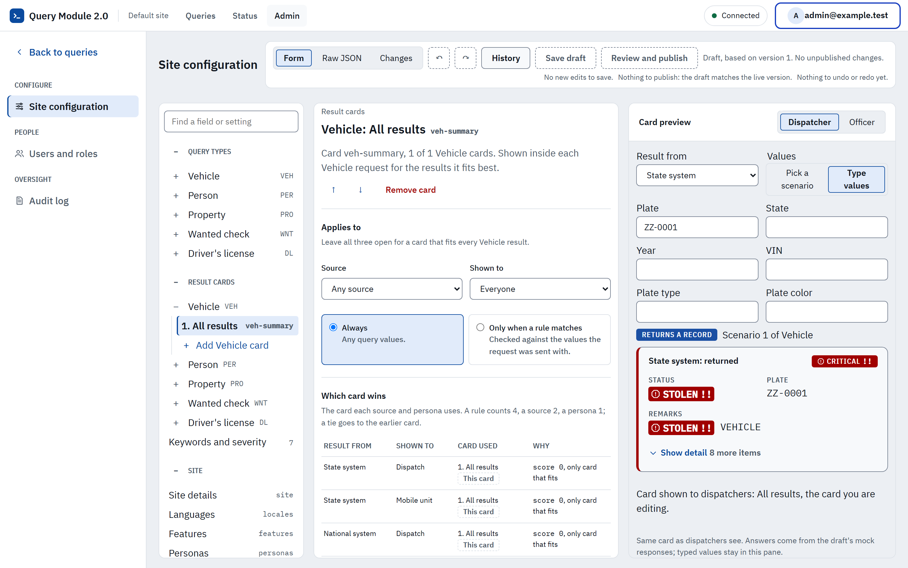
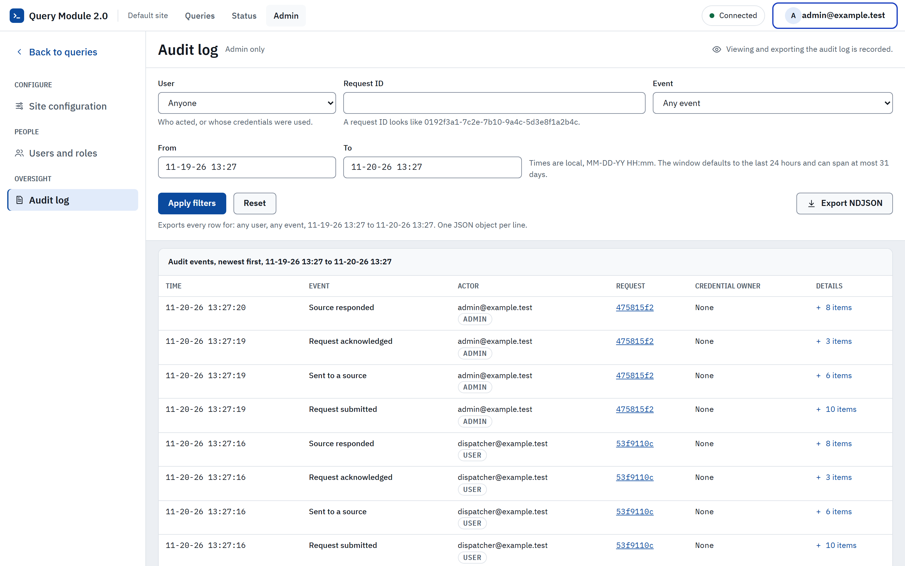
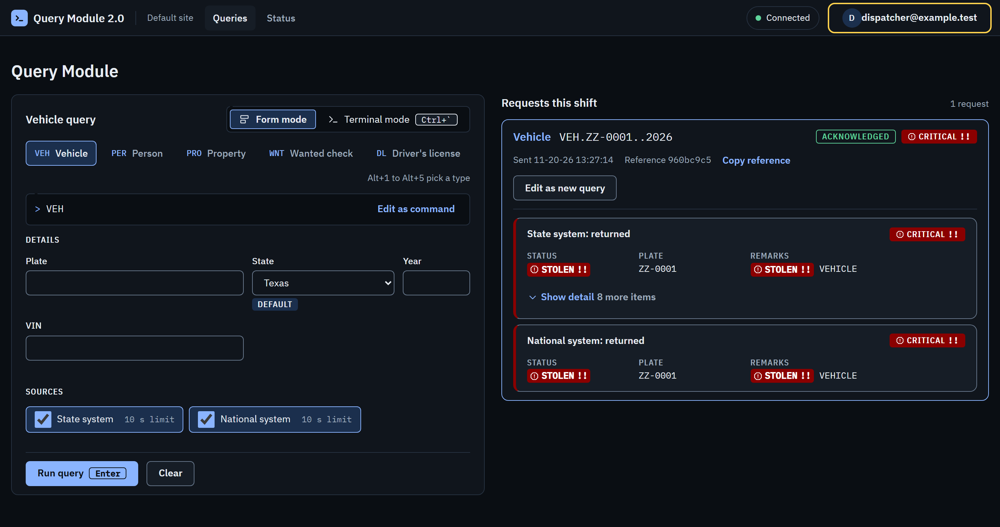
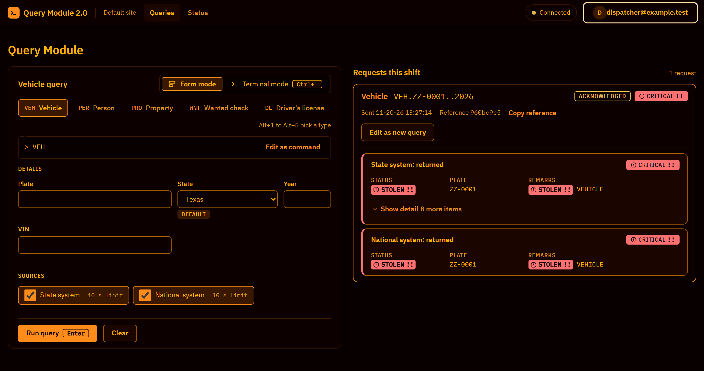
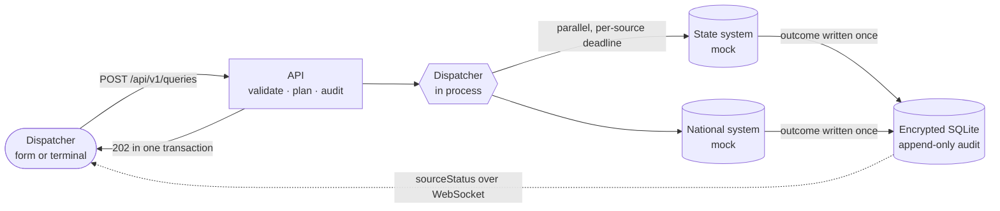

<div align="center">

<picture>
  <source media="(prefers-color-scheme: dark)" srcset="docs/assets/banner-night.svg">
  
</picture>

[](https://github.com/BirchDesignLab/queryModule/actions/workflows/ci.yml)
[](https://github.com/users/BirchDesignLab/projects/1)
[](https://github.com/BirchDesignLab/queryModule/pulls)


**[Live demo](docs/demo.md)** · **[What it does](#what-it-does)** · **[Quick start](#quick-start)** · **[Architecture](docs/architecture.md)** · **[Docs](docs/README.md)**

</div>

A configuration-driven query front end and API for a Computer-Aided Dispatch (CAD) suite.
Dispatchers, records staff and mobile units build a query from a form or a command terminal, and
see each source's answer as a result card inside the request. A site changes its forms, rules,
commands and result cards from an admin console, without a code change or a rebuild.

> [!IMPORTANT]
> This runs on mock data only and is not connected to real state or national systems. It is still
> built to the standard a real connection and use would demand: encryption in transit and at rest, a
> complete audit trail, and security controls rooted directly in CJIS rules. Encrypted storage for
> state-system credentials comes in M3.

<p align="center">
  
  <br>
  <sub>Slash opens the terminal. One command asks both mock sources; each card arrives the moment its source answers.</sub>
</p>

## What it does

<table>
<tr>
<td width="50%" valign="top">

### ⌨️ Form or terminal, one query

Pick a query type and fill the form, or press <kbd>/</kbd> and type `VEH.ZZ-0001..26`. Both build
the same request, checked by the same rules in the browser and on the server. Every flow works
from the keyboard alone.

</td>
<td width="50%" valign="top">

### ⚡ Every source, live

Each submit gets a 202 acknowledgment at once, then goes to every source in parallel, each with its
own deadline. Status streams over a WebSocket; a client that drops off catches up by replay. Nothing
is ever sent twice.

</td>
</tr>
<tr>
<td colspan="2">

<picture>
  <source media="(prefers-color-scheme: dark)" srcset="docs/assets/shots/results-night.png">
  
</picture>

</td>
</tr>
<tr>
<td width="50%" valign="top">

### 🚨 Results you can't miss

Answers show as result cards: a mapped summary, detail tables, and keyword marks. A keyword such as
`STOLEN` or `WANTED` raises the card, the request and the badge to critical, with text and shape as
well as color.

</td>
<td width="50%" valign="top">

<picture>
  <source media="(prefers-color-scheme: dark)" srcset="docs/assets/shots/warrants-night.png">
  
</picture>

</td>
</tr>
<tr>
<td colspan="2">

### 🛠️ Configuration, not code

Query types, fields, rules, commands, sources, result cards and keyword styles are one validated
config document. The admin builder edits it with a live preview drawn by the same renderer the
dispatcher sees, tests keywords with "Try a match", and publishes a new version that reaches open
screens without a reload. Every version keeps its history and its note, and can be rolled back.

<picture>
  <source media="(prefers-color-scheme: dark)" srcset="docs/assets/shots/builder-night.png">
  
</picture>

</td>
</tr>
<tr>
<td width="50%" valign="top">

### 🔏 Audited end to end

Every submit, dispatch, answer and config publish writes an append-only audit row; the database
itself refuses to rewrite or delete one. Admins filter, page and export the log as NDJSON, and reading the log is
itself audited.

</td>
<td width="50%" valign="top">

<picture>
  <source media="(prefers-color-scheme: dark)" srcset="docs/assets/shots/audit-night.png">
  
</picture>

</td>
</tr>
</table>

### 🌗 Built for a dispatch floor at 3 a.m.

Day, Night and Red shift themes keep contrast checked per theme. Red shift protects night vision in
a dark room or a patrol car.

<table>
<tr>
<td></td>
<td></td>
<td></td>
</tr>
<tr align="center"><td><sub>Day</sub></td><td><sub>Night</sub></td><td><sub>Red shift</sub></td></tr>
</table>

## How a query flows



One process, one encrypted database file. The rules live in `packages/core` as pure functions, so
the code that drives the form also guards the API. More: [architecture](docs/architecture.md).

## Security, by design

| | |
|---|---|
| 🔐 Encryption | HTTPS only with HSTS, through a Cloudflare Tunnel (the host publishes no port); the SQLite database encrypted at rest |
| 🗝️ Keys | Docker secret files only; key canaries at startup, and the server refuses to start if a key is missing or wrong |
| 📜 Audit | Append-only: database triggers refuse any update or delete, and CI checks every migration and schema write |
| 🙊 Logs | Structured logs that never carry secrets, key material or query values |
| 🚪 Sessions | Session limits, account lockout and per-IP auth rate limits, an Origin allowlist on REST and the WebSocket, and a sweeper that ends expired sessions |

The full model, with each control marked built or planned: [SECURITY.md](SECURITY.md).

## Where it stands (11-20-26)

| | |
|---|---|
| Built | M0 skeleton; M1 forms, terminal and admin console; M2 P0.5 dispatch to the mock sources with live per-source status; M2 P1 result cards, keyword severity and replay; M2 P2 audit log, admin request view, session sweeper and publish notes |
| In progress | M2 P3 hardening. Merged so far: demo database reset, `config:import`, label-only publishes reaching open screens, foreign-Origin refusal, offline and live-region browser tests. Left: the NVDA screen-reader pass, the host smoke and restore test, and the M2 exit |
| Planned | M3 credentials, MFA, multi-source and delegation; M4 mobile layouts, native app and host-page embedding |

What each milestone delivered: [overview](docs/overview.md). What is planned and not built:
[roadmap](docs/roadmap.md). A live demo runs the latest promoted build (M2 P2, promoted 10-19-26)
with demo accounts ([demo guide](docs/demo.md)).

## Quick start

Needs Node 24 (24.22.1 or newer) and corepack.

```bash
corepack enable
pnpm install --frozen-lockfile
pnpm dev
```

Setup on Windows and Linux, the root scripts and the end-to-end tests:
[getting started](docs/getting-started.md).

<details>
<summary><b>Try these commands</b> (mock data, default site)</summary>

| Command | What you see |
|---|---|
| `VEH.ZZ-0001..26` | `STOLEN` on both sources: critical |
| `VEH.ABC123..26` | `NO RECORD` on both sources |
| `WNT.WANTED` | National system `WANTED`, critical; Show detail opens the warrants table |
| `VEH.FAIL1..26` | A partial result: one source failed, one answered |
| `VEH.TIMEOUT..26` | One card at once; the other source times out at its deadline |

Every story, with the accounts: [demo guide](docs/demo.md#demo-stories).

</details>

## Documentation

| Read this | For |
|---|---|
| [Documentation index](docs/README.md) | Every document, by reader |
| [Overview](docs/overview.md) and [roadmap](docs/roadmap.md) | What exists today and what is planned |
| [Getting started](docs/getting-started.md) | Setup, local run, root scripts, tests |
| [Architecture](docs/architecture.md) | Packages, apps, data flow, repository map |
| [Demo guide](docs/demo.md) | Demo accounts and demo stories |
| [Site configuration](docs/site-config.md) | Changing a site's forms, rules, commands and cards |
| [API reference](docs/api.md) | The HTTP and WebSocket contract |
| [Deploying](docs/deploy.md) | The single-node Docker host |
| [Contributing](CONTRIBUTING.md) | How the work is planned, built and reviewed |
| [Security](SECURITY.md) | The security model and how to report a problem |

## License and provenance

Copyright Birch Design Lab. All rights reserved; see [LICENSE](LICENSE). Third-party components
are listed in [THIRD_PARTY_NOTICES.md](THIRD_PARTY_NOTICES.md).

Most code here is written by AI agents (Claude Code) under one developer's direction, with Opus
review on the sensitive areas. An independent human security review is required before any use
beyond this demo (spec 14).

<p align="center"><sub>Screenshots are retaken from a local build on mock data with <code>node scripts/docs/shots.mjs</code>.</sub></p>
