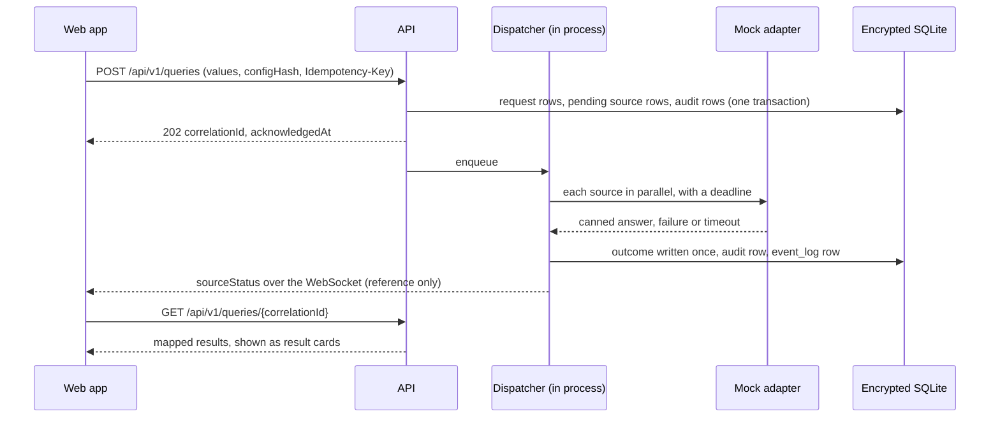

# Architecture

How the Query Module is put together, as built on `main`. Where a part is planned and not built,
this page says so and names the milestone. The binding design is the
[design spec v2](superpowers/specs/2026-09-25-query-module-2-design-v2.md) (section 3) plus the
[decision records](decisions/README.md).

This runs on mock data only and is not connected to real state or national systems. It is still
built to the standard a real connection and use would demand: encryption in transit and at rest, a
complete audit trail, and security controls rooted directly in CJIS rules. Encrypted storage for
state-system credentials comes in M3.

The only source adapter is the built-in mock adapter, which answers from canned files.

## Shape

A pnpm workspace monorepo in strict TypeScript on Node 24. One process and one SQLite database
file, with dispatch and the event bus in process; a single node is a hard limit of the design, not
a stage (spec 2).

- `packages/core` holds the domain logic as pure functions with no IO. The web app and the API both
  use it, so the rules that drive the form also guard the API.
- `packages/api` is the HTTP and WebSocket server under `/api/v1`. It also serves the web build.
- `apps/web` is the browser app for the dispatcher, records and mobile-unit users and the admin
  console.

## One query, end to end

1. The browser keeps the draft as the user's values; `packages/core` derives the form state from it.
2. A submit is checked against the same rules on the server, planned into parts and sources, and
   recorded with its audit rows in one transaction before the 202 acknowledgment.
3. The dispatcher runs each source in parallel within its deadline. Each outcome is written once
   and never rewritten.
4. The WebSocket tells the client which result changed; the client reads it over HTTP. A client that
   was offline catches up by replay from its last sequence number.
5. On restart, a source still `pending` becomes `interrupted`; nothing is sent twice.

## Packages and apps

| Path | Role | State |
|---|---|---|
| `packages/core` | Domain logic and contracts (Zod) | Built: contracts (version, `ApiError`, identity, source status, audit catalog, WebSocket messages, routes, queries, admin), site config schema and validation, rules engine, terminal parser, query planner, mock scenario matcher and fixture policy, response mapper, `assessResult`, keyword highlighter |
| `packages/client` | Framework-neutral client logic | Built: API client, session and sign-in, config and draft state, query submit, requests list and results, WebSocket feed with replay, heartbeat, persona, terminal, announcer, i18n, preferences |
| `packages/tokens` | Design tokens for the day, night and red-shift modes | Built |
| `packages/web-ui` | React DOM components | Built: query panel, fields and forms, terminal, result cards and tables, severity badge, keyword marks, shortcuts, announcer, themes, persona layouts |
| `packages/config` | Shipped sites, locales, mock files, generated JSON Schema | Built: `default` and `example-ok` sites, `en` locale, mock files |
| `packages/api` | HTTP and WebSocket API | Built: sign-in and sessions, query submit, dispatch with the mock adapter, read routes, WebSocket feed with replay, admin console routes and the versioned config store, audit, the encrypted database, key handling, log redaction |
| `packages/rn-ui` | React Native components for native hosts | Planned, M4; not created yet |
| `apps/web` | Vite and React web app | Built: sign-in, query panel (form and terminal), requests with result cards, status page, admin console (site builder with cards, keywords, commands and rules; Try a match; mock editor; publish and history; users) |
| `apps/host-simulator` | Test host page for embedded mode | Planned, M4 P1; holds a README and `package.json` only |
| `apps/mobile` | Expo app for the smartphone user | Placeholder shell so CI's `expo export` runs; replaced in M4 |

## Other folders

| Path | Role |
|---|---|
| `deploy/` | `Dockerfile`, `compose.yml` (the app and its Cloudflare Tunnel service), `.env.example`, and systemd units for the deploy pull and the backup. See [deploying](deploy.md). |
| `scripts/ci` | CI gates: contract and client generators, config validation, license check, story tags, sensitive-review check, migration and schema-write checks |
| `scripts/ops` | Ops scripts: seed, smoke, backup, restore test, deploy pull, lost-key runbooks, roles, sign-in stats, GitHub board setup |
| `scripts/dev` | Dev server, end-to-end launcher, local smoke, demo seed |
| `scripts/mock-data` | Generates the mock files under the fixture policy ([README](../scripts/mock-data/README.md)) |
| `scripts/sdd` | Task briefs, ledger append and the test harness for the saved workflows |
| `scripts/demo` | Keyboard-only dry run of the demo runbook, and re-walk extras |
| `scripts/briefs` | Renders the design brief HTML under `docs/briefs/` to PDF |
| `scripts/design` | Screenshots the approved mockup frames for comparison |
| `scripts/perf` | Opt-in keystroke-cost measurement |
| `scripts/pm` | One-off scripts that created each phase's GitHub issues |
| `scripts/board` | One-off GitHub board chores (milestone closes, follow-up sync) |
| `scripts/migrations` | One-off data migrations |
| `scripts/fonts` | Fetches the IBM Plex font files |
| `.claude/workflows` | The saved workflow scripts that run plan tasks and reviews (see [contributing](../CONTRIBUTING.md)) |
| `.claude/agents` | Model and effort role definitions for agent dispatch |
| `docs/` | This documentation and the project records ([index](README.md)) |

## Modes

The design has two identity modes (spec 3.1):

- **Standalone** (built): the web app's own email and password sign-in, used by the live demo.
- **Embedded** (planned, M4): a CAD host page frames the module and hands it the host's signed-in
  user over a versioned postMessage protocol, tested against `apps/host-simulator`; a native host
  embeds `packages/rn-ui` instead.

Both modes share one API, one database schema and one audit trail.

## Configuration, not code

A site's query types, fields, rules, picklists, commands, sources, result cards, keyword styles,
shortcuts and theme are one validated config document. The first start loads the bundled site file
as version 1; after that the admin console publishes new versions, and every open dispatcher screen
picks the change up at its next config refresh (ADR-0011). Details: [site configuration](site-config.md).

## Security model

Summarized in [SECURITY.md](../SECURITY.md), with each control marked built or planned.
