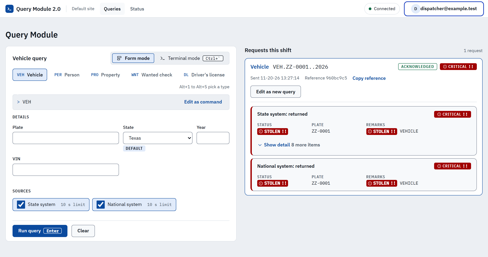
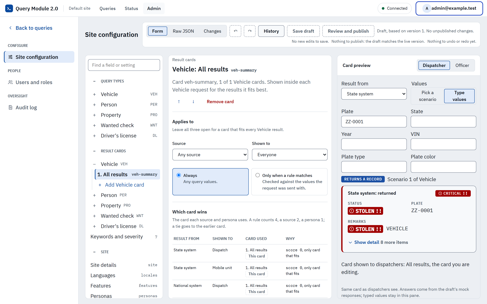
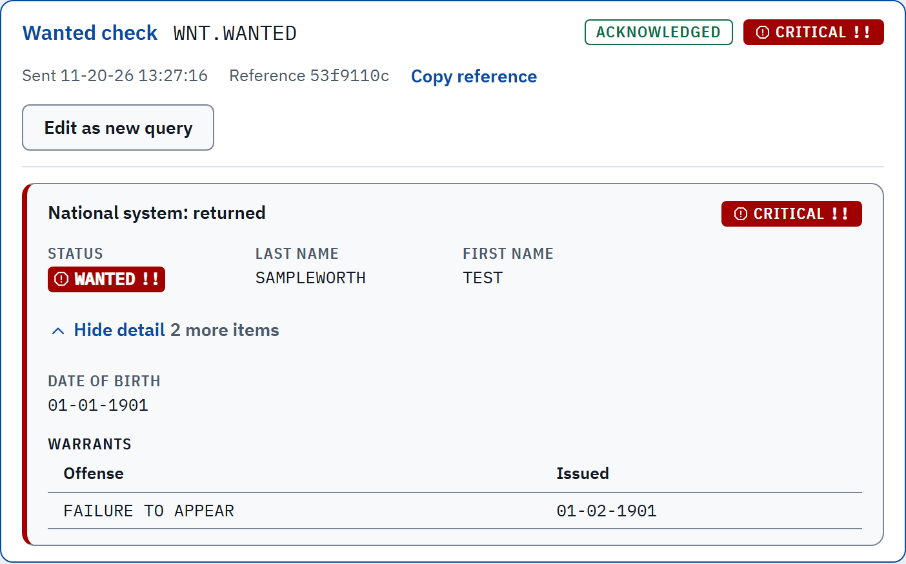
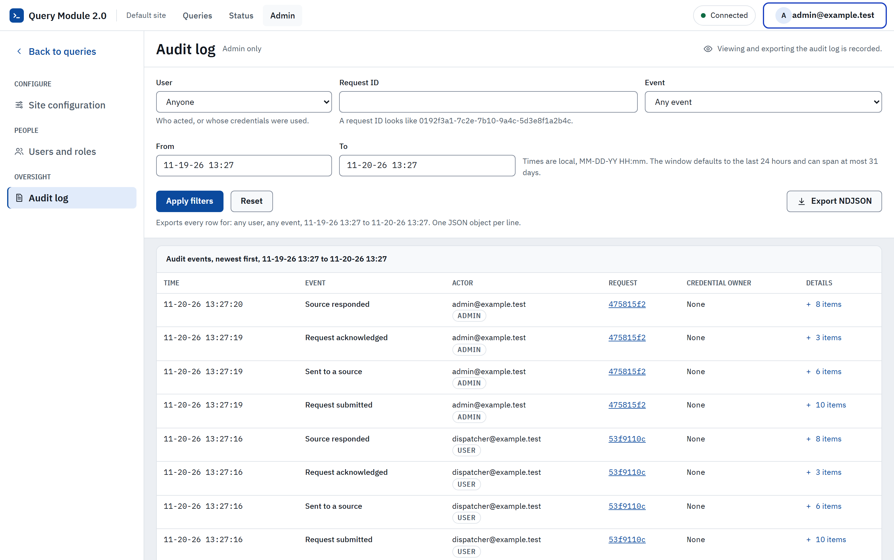

# Overview: what exists today

Last refreshed 11-20-26, during M2 P3 hardening. This page lists only what is built and merged on `main`.
Planned work is on the [roadmap](roadmap.md).

> This runs on mock data only and is not connected to real state or national systems. It is still
> built to the standard a real connection and use would demand: encryption in transit and at rest, a
> complete audit trail, and security controls rooted directly in CJIS rules. Encrypted storage for
> state-system credentials comes in M3.

## What the Query Module is

A query front end and API for a Computer-Aided Dispatch (CAD) suite. The users are dispatchers at a
desk, records staff, and officers in a vehicle (the mobile unit). Each builds a query (a vehicle by
plate, a person, a driver's license, a warrant, an article of property) from a form or by typing a
command, sends it to one or more sources, and reads each source's answer as it arrives.

<picture>
  <source media="(prefers-color-scheme: dark)" srcset="assets/shots/results-night.png">
  
</picture>

The product requirement is the
[requirements definition](../Requirements%20Definition%20-%20Query%20Module%20Usability%20Enhancements.md);
the design is the [design spec v2](superpowers/specs/2026-09-25-query-module-2-design-v2.md).

The sources in this repository are mock sources named "State system" and "National system". They
answer from canned files of fictitious records (the fixture policy: plates `ZZ-####`, dates of birth
in 1901, synthetic names). There is no adapter for a real system.

## Built, by milestone

| Milestone and phase | Status | Release note |
|---|---|---|
| M0 Skeleton | Done 09-28-26, tag `m0` | [m0.md](releases/m0.md) |
| M1 Forms and terminal | Done 10-04-26, tag `m1` | [m1.md](releases/m1.md) |
| M2 P0 Contracts | Done; full contract gate 10-16-26 | none (no release note for a contracts phase) |
| M2 P0.5 Dispatch | Done, promoted 10-07-26 | [m2-p0-5.md](releases/m2-p0-5.md) |
| M2 P1 Feed | Done, promoted 10-15-26 | [m2-p1.md](releases/m2-p1.md) |
| M2 P2 Audit | Done, promoted 10-19-26 | [m2-p2.md](releases/m2-p2.md) |
| M2 P3 Hardening | In progress; exit gate not yet run | none yet |

### M0 Skeleton

- The workspace, CI, the Docker image and the live demo host behind a Cloudflare Tunnel.
- Sign-in with email and password, session limits, an auth rate limit, and the WebSocket heartbeat.
- The encrypted database, the append-only audit table, keys loaded from Docker secrets and checked
  by canaries at startup, and logs that never carry secrets or query values.
- The site config schema (version 1), `config:validate` and `config:migrate`.

### M1 Forms and terminal

- The dispatcher query panel: quick-access buttons, the form with its rules (visible, required,
  read-only, defaults), and a command terminal that maps typed commands to the same query.
- Keyboard-first use: single-key, modifier and chord shortcuts, with every flow completable without
  a mouse.
- The officer (mobile-unit) layout in a desktop browser, and the day, night and red-shift themes.
  The Toughbook-class layouts are planned for M4.
- The admin console: a visual site builder with a same-renderer preview, undo and redo, a changes
  view, publish, history, export and roll back, and user administration. Publishing reaches open
  dispatcher screens without a reload (ADR-0011).
- A submit is validated, recorded and audited, and answered with a 202 acknowledgment.

<picture>
  <source media="(prefers-color-scheme: dark)" srcset="assets/shots/builder-night.png">
  
</picture>

### M2 P0.5 Dispatch

- Each submit is dispatched in the background to the mock sources, in parallel, each with its own
  deadline. Each source settles once: returned, failed or timed out.
- Live per-source status on the dispatcher's screen over the WebSocket.
- A restart marks unfinished sources `interrupted`; nothing is dispatched twice.

### M2 P1 Feed

- Results appear inside each request as result cards: a mapped summary and detail, tables, keyword
  marks, a severity badge, and a generic view when no card is configured.
- A client that was offline catches up by replay; the requests list survives a reload.
- Cards and keywords are configured in the admin builder, with "Try a match" to test a keyword
  against a sample answer.
- "Edit as new query" loads a past request's values into the form under the current config.
- A demo scenario pack, a one-time demo seed, and a keyboard-only dry run of the demo runbook.

<picture>
  <source media="(prefers-color-scheme: dark)" srcset="assets/shots/warrants-night.png">
  
</picture>

### M2 P2 Audit

- An audit log in the admin console: filters, paging, and an NDJSON export. Reading or exporting
  the log is itself audited.
- An admin opens any request read-only from the log, with its values and answers; the view is
  audited before anything is shown.
- A session sweeper ends sessions at their live limits, each with an audit row, and prunes the
  replay log hourly.
- Each config publish can carry a short note; the history shows it with the publisher's name.
- Acknowledgment timing: the 202 reports `Server-Timing` from request receipt, and the client's
  receipt is logged as a metric with an ops summary script.
- The terminal can sit beside the results, chosen in the account menu.
- `config:validate` checks result-card paths against the mock answers and gains `--diff <tag>`;
  bearer sign-in is tested on REST and the WebSocket.

<picture>
  <source media="(prefers-color-scheme: dark)" srcset="assets/shots/audit-night.png">
  
</picture>

### M2 P3 Hardening (in progress)

- `db:reset` resets the demo database (#830, ADR-0015; follow-ups in #833, ADR-0016).
- `config:import` brings an image's site file in as a new draft or version, and the client config
  carries `versionId` (#826).
- A label-only publish now reaches open screens without a reload (#834).
- Foreign-Origin requests are refused with 403, change-password is rate limited, and the M2 security
  map is written (#819).
- `CORS_ORIGINS` is checked at boot (#823).
- Sweeper, drain and admin-route fixes (#818).
- Browser tests for going offline and for typing while a result arrives, plus flake fixes (#820,
  #824).
- Mockup v6 gaps closed: audit band, rail icons, source lines, dialogs, terminal pane and the
  purged-result meta line (#839, #841).
- CI shards the image job's Playwright run into three e2e jobs (#837).
- An NVDA with Chrome test script for the M2 exit (#843).
- Dependency fixes: Node 24.22.1 (#847), node-forge 1.4.3 (#852), hono 4.13.19 and
  @hono/node-server 2.1.9 (#858).

Still to come in P3: the NVDA pass, the host smoke and backup restore test, the M2 release note and
the m2 promote.

## The live demo

The latest promoted build, M2 P2 (10-19-26), runs at https://querymodule.birchdesignlab.com with demo
accounts. The M2 P3 work above is on `main` but not yet promoted. The
accounts, the demo stories and the runbook are in the [demo guide](demo.md); the
[M1 runbook](demo/m1-v1.md) is kept as the M1 record. The design brief for M2 P1 is in
[docs/briefs](briefs/).

## Quality and size, as of 11-20-26

- `pnpm verify` on Windows on 11-20-26 (run on #858 and again for #859): green, with 418 test
  files (415 passed, 3 skipped on Windows) and 5,884 tests (5,879 passed, 5 skipped), and 156 of 156
  workflow harness scenarios. CI on Linux runs the process tests Windows skips.
- `pnpm audit --prod`: no new advisory; 5 reviewed advisories in Expo and React Native build tooling
  under `apps/mobile` (glob, minimatch, braces, zod, deepmerge) are ignored in `pnpm-workspace.yaml`.
- Every end-to-end scenario runs axe with zero serious or critical findings.
- 349 pull requests merged; 453 issues closed and 41 open.
